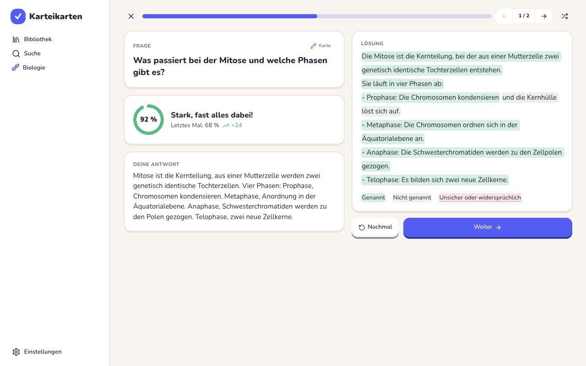
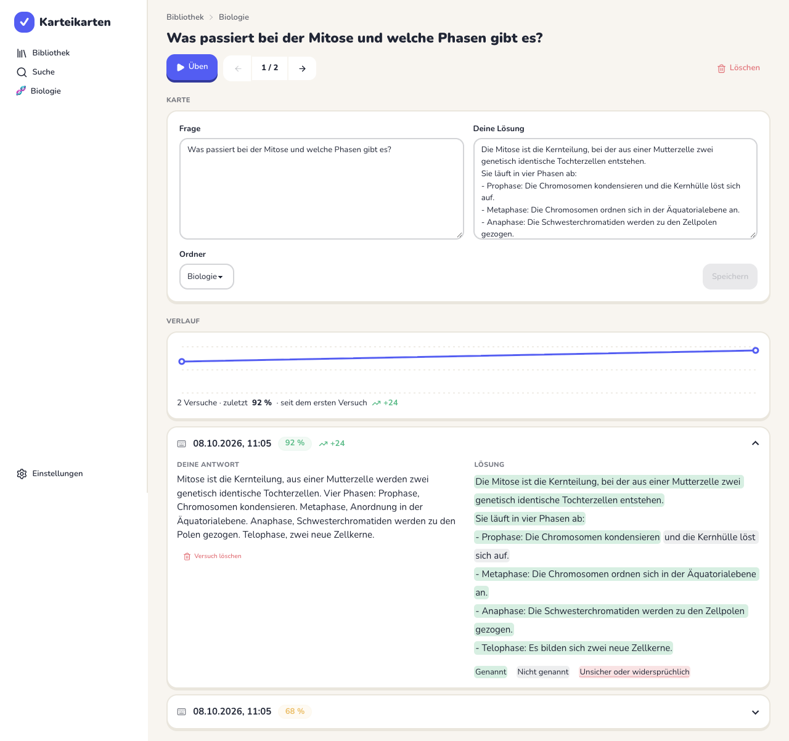

# Karteikarten

A deliberately simple flashcard web app with one twist: you store your own solution for each
card, answer by **speaking or typing**, and an AI marks which parts of your solution you
actually covered, including things you said in your own words.

- **Green**: you said it, literally or in meaning
- **Grey**: you did not mention it
- **Red**: the AI is unsure, or you said something that contradicts the solution

Every run is saved per card, so you can see whether you are getting better over time.

| Result after answering | History of one card |
|---|---|
|  |  |

The interface is in German. It runs in any modern browser and is laid out for iPad first, so
it works on tablets, phones, Mac and Windows alike. On iPad you can add it to the home screen.

## Features

- Folders with any depth of subfolders, cards with question and solution side by side; folders and cards can be moved
- Bulk import: paste two columns from a spreadsheet, or load a CSV/TSV/text file
- Study a folder including all of its subfolders, only its weak cards, or a single card
- Jump back and forth between cards while studying (buttons or arrow keys), shuffle, or just reveal a solution
- Leave a study session at any point and continue it later where you stopped
- Search across all questions and solutions
- Voice answers of any practical length: recorded in the browser, transcribed by an AI model
- Typed answers as an alternative, and you can correct the transcript before grading
- Per-card history with score trend and the graded solution of every attempt
- Light and dark theme
- JSON backup and restore

## Getting started

Requirements: Node.js 22 or newer and [pnpm](https://pnpm.io).

```bash
pnpm install
cp .env.example .env.local   # then add your OpenRouter key
pnpm dev
```

Open http://localhost:3000.

### Configuration

| Variable | Required | Default | Purpose |
|---|---|---|---|
| `OPENROUTER_API_KEY` | yes | | Key from [openrouter.ai/keys](https://openrouter.ai/keys) |
| `GRADING_MODEL` | no | `openai/gpt-6-luna` | Model that compares answer and solution |
| `TRANSCRIBE_MODEL` | no | `google/gemini-3.8-flash` | Model that transcribes recordings; must accept audio input |

### Using the microphone on another device

Browsers only allow microphone access over HTTPS or on `localhost`. To test on an iPad in your
local network, run `pnpm dev --experimental-https` and open the `https://` address, or deploy
the app.

## Where is my data?

The app runs in one of two modes, decided by the environment:

**Local mode (default).** Folders, cards and attempts are stored in your browser (IndexedDB).
No account, no server database, no sync. Use *Einstellungen → Backup* to move data or keep a copy.

**Server mode.** With a Postgres database and Neon Auth configured, users sign up and sign in,
and their library syncs between all their devices. The browser still keeps a local copy and
works on it directly, so the app stays fast; changes are sent to the server in the background.

Sent to the AI provider in both modes: the question, your solution and your answer for
grading, and the audio recording for transcription.

## Accounts, sync and MCP (server mode)

1. Create a [Neon](https://neon.com) project and enable **Auth** on its branch.
2. Put `DATABASE_URL`, `NEON_AUTH_BASE_URL` and `NEON_AUTH_COOKIE_SECRET` into `.env.local`
   (see `.env.example`). With the Neon CLI linked to the project, `neon env pull` writes the
   first two.
3. Create the tables: `pnpm db:migrate`
4. Start the app. It now asks you to sign in.

Data you created in local mode before your first sign-in on a device is added to your account.
Signing out removes the local copy from that device; the library stays in the account.

### How sync works

- Every row carries the time of its last change. If two devices change the same card, the
  later change wins. Deletions are synced too.
- A device syncs shortly after each change, when its tab becomes visible again, when the
  network returns, and every 30 seconds while open.
- Resumable study sessions are per device and are not synced.

### Letting Claude work on your library (MCP)

The app exposes an [MCP](https://modelcontextprotocol.io) endpoint at `/api/mcp`, built with
the official TypeScript SDK. An assistant connected to it can read the library and learning
history and create, edit, move and delete folders and cards, for example to turn lecture
notes into flashcards. Changes show up in the app on the next sync.

1. In the app, open *Einstellungen → Zugriff für Claude (MCP)* and create an access token.
   It is shown once.
2. Connect your client. For Claude Code:

   ```bash
   claude mcp add --transport http karteikarten https://your-host/api/mcp \
     --header "Authorization: Bearer kk_..."
   ```

A token has full access to its account, including deleting; revoke it in the same place.
Clients that can only connect through OAuth (rather than a header) are not supported yet.

Tools: `get_overview`, `list_cards`, `get_card`, `create_folder`, `update_folder`,
`delete_folder`, `create_cards`, `update_card`, `delete_card`.

## How grading works

1. The model splits your solution into small statements and labels each one as `correct`,
   `missing` or `unsure`.
2. The server maps those statements back onto your original text. If the model changed or
   skipped any of it, the result is discarded and requested again.
3. If that fails twice, the server splits the solution into sentences itself and only asks
   the model for a label per sentence.

This way the solution you see is always your own text, never a rewritten version. The score
is the share of the solution (by characters) that was labelled `correct`.

Limits: grading quality depends on the model; it can be wrong, which is why uncertain parts
are shown in red rather than guessed.

## How long recordings work

Hosts like Vercel cap a request body at 4.5 MB, which is about two minutes of 16 kHz WAV.
Instead of uploading one file at the end, the browser cuts the recording into pieces of 45 to
60 seconds while you are still speaking, always at the quietest moment in that window so a
cut falls into a pause. Each piece is transcribed right away and the texts are joined in
order. This removes the length limit without extra storage, and most of the transcript is
already done when you stop. A recording ends on its own after 30 minutes.

## Project structure

```
src/app/                 routes (library, folder, card, study session, settings)
src/app/api/grade        compares answer and solution
src/app/api/transcribe   speech to text
src/components/          UI components
src/lib/repo.ts          data access in the browser (IndexedDB)
src/lib/sync.ts          browser half of the sync
src/server/              database schema, server half of the sync, MCP server, access tokens
drizzle/                 database migrations
src/lib/grading.ts       segment alignment, sentence splitting, scoring
src/lib/audio.ts         cutting a running recording into pieces, WAV encoding
src/lib/importCards.ts   parsing pasted tables and CSV files
docs/design-references/  screens of other flashcard apps used as inspiration
```

## Scripts

```bash
pnpm dev         # development server
pnpm build       # production build
pnpm test        # unit tests (Vitest)
pnpm lint        # ESLint
pnpm typecheck   # TypeScript
pnpm db:generate # create a migration after changing src/server/schema.ts
pnpm db:migrate  # apply migrations to DATABASE_URL
```

## Tech stack

Next.js 16 (App Router), React 19, Tailwind CSS 4, daisyUI 5, Dexie (IndexedDB), AI SDK 7
with the OpenRouter provider, Vitest.

## Roadmap

- OAuth for the MCP endpoint, so clients without custom headers can connect
- Spaced repetition scheduling
- Offline support
- Images in cards

## License

[MIT](LICENSE)
